# 第三方程序拿宿舍用电数据的方法

用以下的方法拿宿舍用电数据可以绕过企业微信的官方前端，可以自行实现统计/预警消息发送等功能/以及任意你想DIY的东西，总之就是很自由就是了

本文件由pandoc生成并进行了手动调整。

## 1 获取登录token

要求：手机能联网，安卓版本6以上，有至少100MB空间

### 1.0
下载PCAPdroid（emanuele-f/PCAPdroid，下载地址→[PCAPdroid.apk](https://github.com/emanuele-f/PCAPdroid/releases/download/v2.0.0/PCAPdroid_v2.0.0.apk)）以及PCAPdroid-mitm（emanuele-f/PCAPdroid-mitm，下载地址→[PCAPdroid-mitm.apk](https://github.com/emanuele-f/PCAPdroid-mitm/releases/download/v2.4/PCAPdroid-mitm_v2.4_arm64-v8a.apk)）

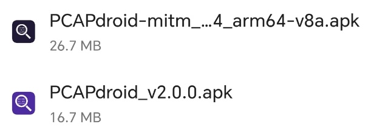

### 1.1 pcap侧的准备

#### 1.1.1
打开PCAPdroid-mitm（以下简称mitm），**放在后台保活不要关掉**，然后打开PCAPdroid（以下简称pcap）

#### 1.1.2
在pcap主页右上角的设置里找到“TLS解密”，打开

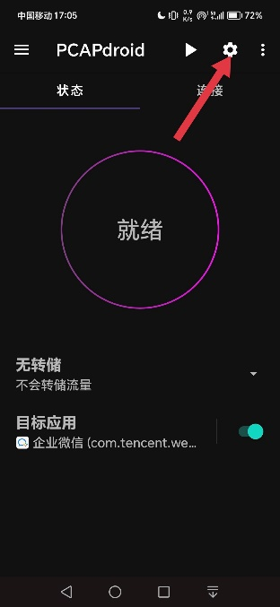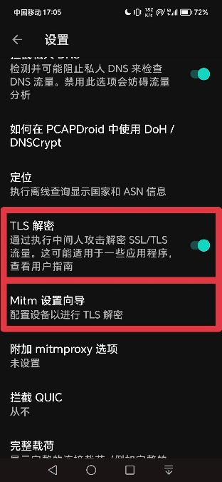

#### 1.1.3
在底下有个“Mitm设置向导”，点进去

#### 1.1.4
下一步→下一步→安装证书（下载证书，然后在手机的设置里搜“证书”就行，注意不是安装WiFi证书，最好能找到一个叫“CA证书”的选项，点进去之后导入你下载的证书就行），安装完了下一步→完毕

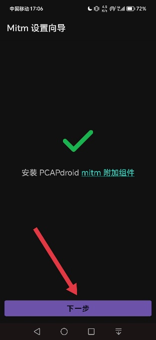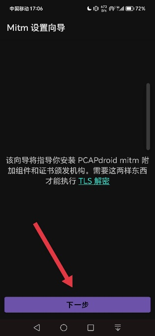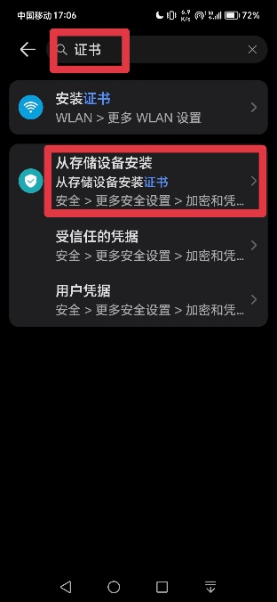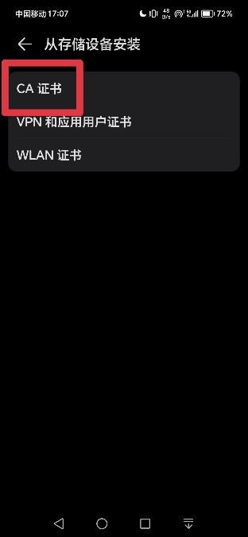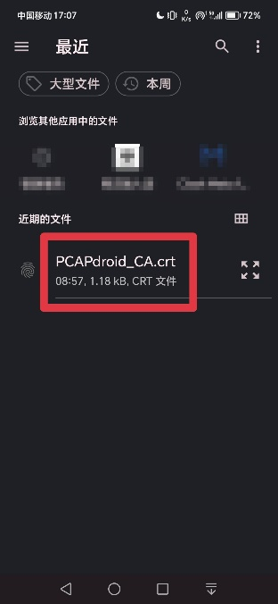

#### 1.1.5
回到pcap主界面，在左上角菜单里面找到“解密规则”

#### 1.1.6
点右上角的加号-应用程序，搜索“企业微信”或者直接往下翻找到企业微信

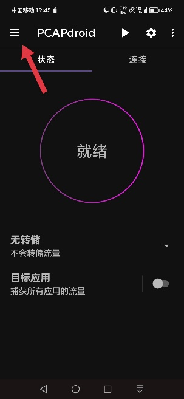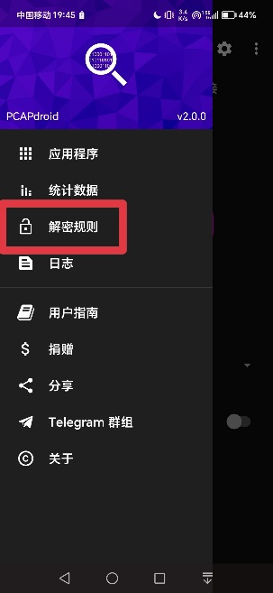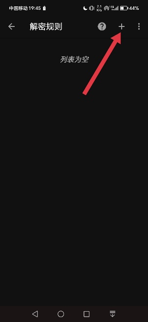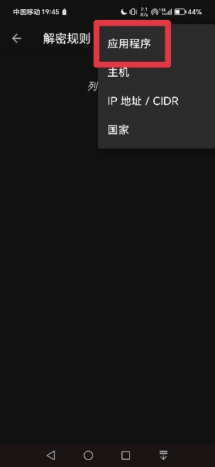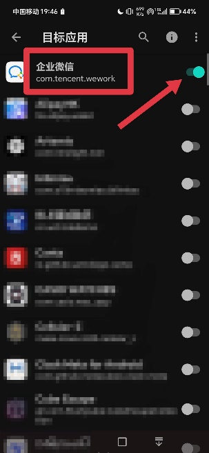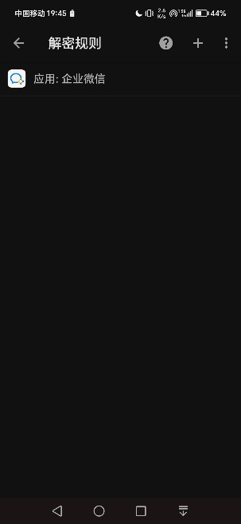

#### 1.1.7

回到主界面，点“目标应用”，找到“企业微信”并且选中，然后回到主页把“目标应用”旁边的开关打开
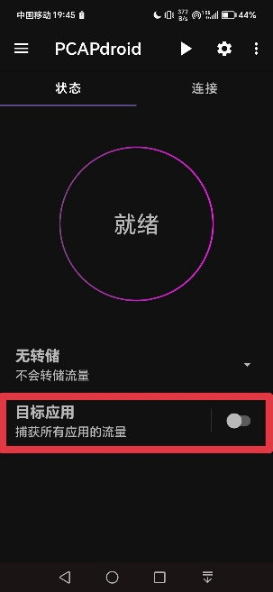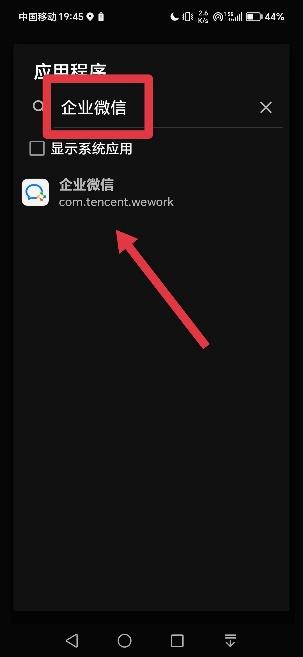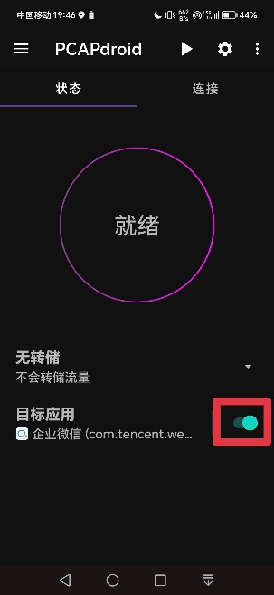
pcap侧准备完毕。

### 1.2 企业微信侧的准备

#### 1.2.1
打开企业微信-底下“工作台”-“校园服务”-“宿舍用电缴费”

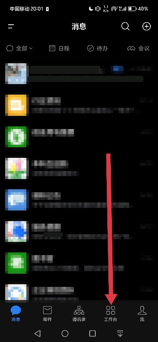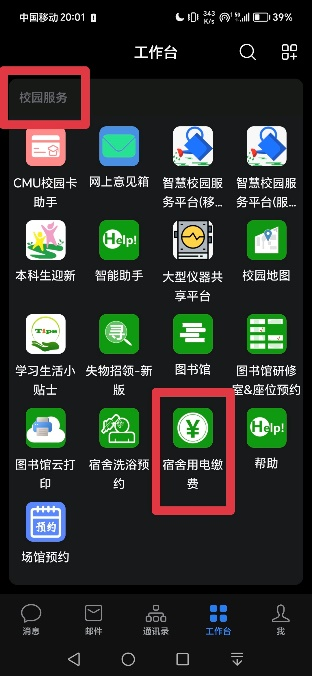

#### 1.2.2
点底下“用电交费”，往下翻一下找到“近6个月用量明细”，不用点进去
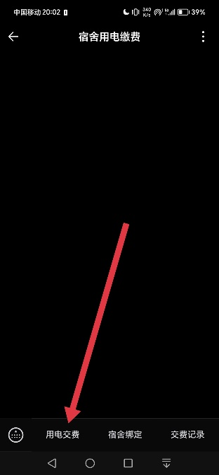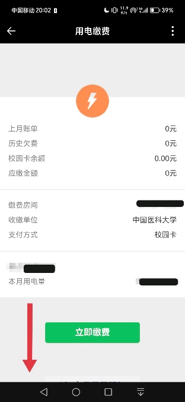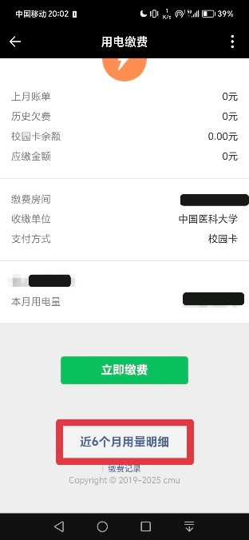

### 1.3 开始抓包

注意这块比较吃手速，越快越好

#### 1.3.1
切到pcap（**注意mitm全程都要在后台保活**），点“就绪”大圆按钮，如果弹VPN提示了就点“好的”

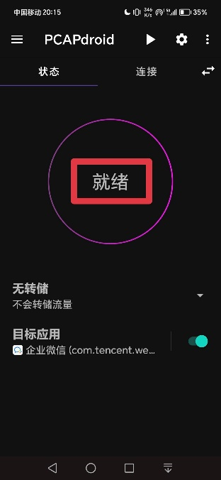

#### 1.3.2
尽快切到企业微信，点进去“近6个月用量明细”，等加载出来

#### 1.3.3
尽快切回来，点右上角的小方块停止键

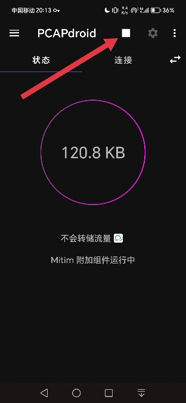

### 1.4 分析抓包结果

#### 1.4.1
点到“连接”选项卡，往下翻一下应该能找到唯一一个标着小绿锁的条目，如果有不止一个那说明你上一步手速慢了，但是也无所谓，找到底下写着“ssyd.cmu.edu.cn”的那个就行
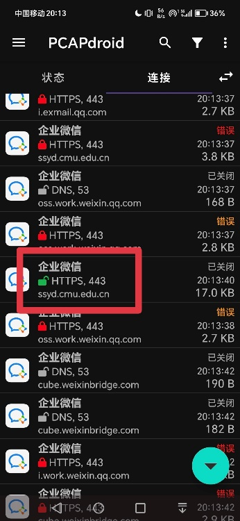

#### 1.4.2
点进去，然后点到“HTTP”选项卡，最上边会有一坨红色的文本，最底下有一坨十六进制，找到“nfine_loginuserkey_2016=”

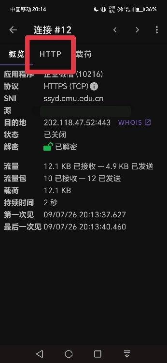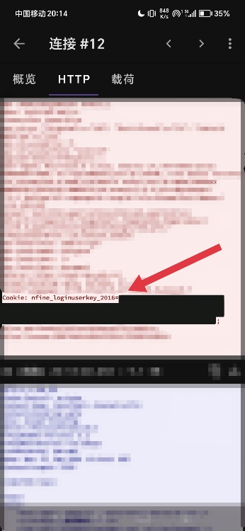

#### 1.4.3
这个“=”后面，直到“;
”前面的一坨十六进制，这个就是你的登录token，复制下来保存好。

然后就不需要pcap和mitm了，如果你手机空间不够可以卸载掉，CA证书记得也删掉

## 2 使用

```python
import zoneinfo, win32com.client
from datetime import datetime
from bs4 import BeautifulSoup


def getusage(loginuserkey: str) -> list[tuple[datetime, float]]:
    http = win32com.client.Dispatch("MSXML2.ServerXMLHTTP.6.0")
    http.open("GET", "https://ssyd.cmu.edu.cn/Home/UsageDetail", False)
    http.setRequestHeader(
        "User-Agent",
        "Mozilla/5.0 (compatible; CMUStudentUtilBot by SOME RANDOM STUDENT contact at wflingseaer at gmail dot com; ) wxwork/5.0.9 MicroMessenger/7.0.1 Language/zh Lang/zh wwmver/3.26.509.642",
    )
    http.setRequestHeader(
        "Accept",
        "text/html,application/xhtml+xml,application/xml;q=0.9,image/avif,image/wxpic,image/webp,image/apng,*/*;q=0.8,application/signed-exchange;v=b3;q=0.7",
    )
    http.setRequestHeader("X-Requested-With", "com.tencent.wework")
    http.setRequestHeader("Referer", "https://ssyd.cmu.edu.cn/")
    http.setRequestHeader("Cookie", f"nfine_loginuserkey_2016={loginuserkey}")
    http.send()
    if http.status != 200:
        raise RuntimeError(f"HTTP {http.status}")
    soup = BeautifulSoup(http.responseText, "html.parser")
    results = []
    for item in soup.find_all("div", class_="usage-item"):
        time_div = item.find("div", class_="record-time")
        value_span = item.find("span", class_="usage-value")
        if not time_div or not value_span:
            continue
        dt = datetime.strptime(
            time_div.get_text(strip=True), "%Y/%m/%d %H:%M:%S"
        ).replace(tzinfo=zoneinfo.ZoneInfo("Asia/Shanghai"))
        val = float(value_span.get_text(strip=True).removesuffix(" kW·h"))
        results.append((dt, val))
    return results
```

（你主力不是python的话上边这坨丢给AI翻译成别的语言就行）

如果你能看懂上边这个程序，那你大概会发现写的真是一坨，无可置疑的一坨。这是因为学校的服务器就是一坨，都不知道哪个世纪的古董服务器以及神秘古董协议，我只能顺从它（摊手）

哦以及，我毫不怀疑它只有一个傻token鉴权，过期限速风控什么的都没有的，至少我用下来是没遇到什么问题

## 3 可能出现的问题

- 1.2.2找不到用电量明细：打开之后的页面就是看不到的，你得往下扒拉一下才能看到，它在底下

- 1.4.1找不到带小绿锁的项目：

  - 如果有ssyd.cmu.edu.cn但是没有小绿锁：检查一下1.1.1~1.1.4都做对了没有，以及mitm有没有放在后台保活

  - 如果没有ssyd.cmu.edu.cn：企业微信那边等它页面加载出来之后再回去pcap那边停抓包

- 1.4.2找不到这个2016什么的：要登录企业微信并且已经绑定了宿舍号才行，以及如果你有多余动作（除了用电量明细之外还点了别的）也可能找不到

- 失败了要从哪步开始重来：先把pcap从后台杀掉，然后从1.3.1开始重来，如果你企业微信退掉了那就从1.2.1开始重来

# 免责声明

## 使用了本文提供的技术和/或软件和/或代码，即表示你知晓使用之的合理范围，明确可能存在的风险，并愿意自行承担可能的后果，包括但不限于处分、行政处罚甚至刑罚！技术提供者（本文作者）不对使用此技术进行的任何行为负责！
